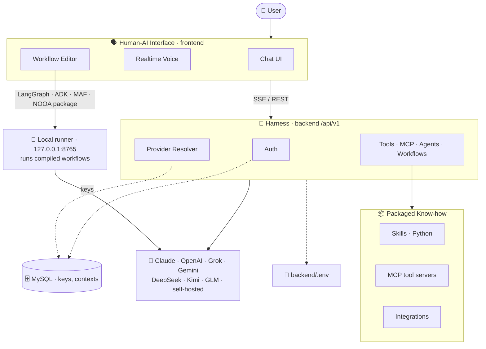

# GPT - New generation Harness

**Design an agent workflow once, debug it live, then compile it for the agent framework you choose:
LangGraph, Google ADK, Microsoft Agent Framework or NVIDIA OO Agents.**

GPT is a self-hostable AI platform built around a **harness**. The harness is the runtime that sits
between people, models and tools: it picks the provider, keeps the keys, calls the tools, runs the
agents and records what happened. Most agent builders *are* one harness: the workflow you draw only
runs inside their engine. GPT works differently. You design and debug in its own interpreter, then a
**compiler** turns the same canvas into ordinary, self-contained Python for one of **four
production frameworks**. You can read that code, keep it and run it without this app.

It brings together:

- 🧠 **A multi-provider harness.** **Claude, OpenAI, Gemini, Grok, DeepSeek, Kimi, GLM** and
  self-hosted OpenAI-compatible models (vLLM, Gemma) behind one API. It adds streaming, tool calling,
  MCP, memory, agents and workflows. Provider keys and endpoints are managed per organisation and per
  user. The same API comes in three implementations: PHP (the reference), TypeScript and Python.
- 🛠️ **A workflow compiler.** A visual editor with an in-browser interpreter, live monitoring and
  four code generators (see [Workflows](#workflows-interpret-to-design-compile-to-ship)).
- 🗣️ **A human‑AI interface.** Chat with compare and verify modes, an artifact pane, realtime
  voice, and a workflow editor where a run's questions and approvals appear in the conversation.
- 📦 **Packaged know‑how.** Skills (Python that runs in your browser), MCP connectors, reusable
  code components, playbooks and automations that tie a workflow to ServiceNow, Outlook or SharePoint.

> **Status:** standalone, self‑hostable. Secrets live outside the repo — see [Configuration](#configuration--secrets).

---

## Three ways to use it

| | **Individual** | **Corporate** | **Hosted service** |
|---|---|---|---|
| **Who it's for** | One person, noncommercial use | A company and its staff | Us, or anyone running a classic web host |
| **How it's delivered** | Docker container on your own machine | Docker container on the company intranet | Apache + PHP + MySQL, no container |
| **LLM access** | Your own provider keys, **or** an account with us: a subscription or prepaid credits | Your own provider keys, **or** an account with us: a subscription or prepaid credits, shared by all staff | Keys configured by whoever runs the server |
| **Admin app** | Not included | Included: manage users, roles, LLM settings, MCP servers and usage | — |
| **Sign-in** | Your own account on your own machine | One account per person, with a single sign-in shared by the app and the admin app | — |
| **What you set up** | Docker, then the [setup wizard](#the-setup-wizard) | Docker on an intranet server, then the same [setup wizard](#the-setup-wizard) | The manual install |
| **Install guide** | [Individual install](#individual-install-docker) | [Corporate install](#corporate-install-docker-on-your-intranet) | [Manual install](#manual-install-apache--php) |

---

## Workflows: interpret to design, compile to ship

### Single harness vs. compiled harness

Most agent platforms are **interpreted, single-harness** systems. The workflow is data that their
engine reads at run time, so it runs only where that engine runs, with the features that engine has.
Debugging means reading that engine's logs, and moving to another framework means starting over.

GPT keeps the interpreter for **design time** and adds a compiler for **run time**:

| | Interpreted single harness | GPT |
|---|---|---|
| **Where the workflow runs** | Only inside the vendor's engine | In GPT's interpreter while you design it; anywhere Python runs once it is compiled |
| **Target frameworks** | One | **Four**: LangGraph, Google ADK, Microsoft Agent Framework, NVIDIA OO Agents |
| **What you ship** | A workflow definition that needs the platform | Plain Python packages, plus requirements, `.env.example`, README and ARCHITECTURE.md |
| **Lock-in** | The workflow is tied to the platform | The code is yours: read it, review it, version it, change frameworks later |
| **Debugging** | Whatever the engine logs | Step through in the editor first, then watch compiled runs live through the same event protocol |
| **Testing before production** | Usually in production, on the engine | Run in the browser interpreter, on the server, or compiled on your machine, and compare |
| **Deployment shapes** | Fixed by the platform | One file, one file per agent, or one A2A service per agent |

### Design and debug in the interpreter

The editor (Drawflow canvas) runs the workflow **node by node** while you build it, so you see each
step before compiling anything:

- **Per-node Input, Output and Logs** for every node of a run, and the branch a dispatcher chose (and
  the ones it skipped) drawn on the canvas.
- **Three ways to run the same canvas**: the browser interpreter, the server (`/workflows/{id}/run-stream`),
  and the compiled code on your machine. Running all three is how you check the compiled code does
  what the design did.
- **Live monitoring** of server and scheduled runs: an overlay follows the events as they happen,
  and the run log keeps them for later.
- **Code nodes are tested in the browser.** Their Python runs in a Pyodide worker against your real
  MCP servers, with a harness that checks the code and refuses unsafe modules. The **code assistant**
  writes a node's code and exits from the MCP servers' own tool docs. You review a diff and accept it.
- **Validation before compiling.** Structured outputs (a JSON Schema per node), playbook validation,
  and the compiler refuses what a target can't do, telling you which node and why.

### The building blocks

- **Start** with a prompt, a **schedule** (cron) or an **event**. An event start is a code component
  such as "new Outlook mail", "new ServiceNow job" or "file dropped in a folder"; its exits become the
  Start node's branches. One workflow per user can be *active*: an event worker watches its source and
  starts a run on each event.
- **Agents** on any provider, with their own tools, MCP servers and skills.
- **Dispatchers** route to **one** branch, not all of them. The router is an LLM or a decision model
  (TypeSafe Jev or OpenAI Decisions), with a confidence floor and a catch-all branch.
- **Playbooks** run a step-by-step procedure, written in prose with `#Action` references, as an
  interpreter loop. It includes **human gates**: forms, approvals and hand-offs that show up in the
  conversation, or end the run cleanly when it is unattended.
- **Code nodes** run deterministic Python `run(input, call_tool)` with named exits; only the exit
  taken runs next. The **Code Library** keeps reusable components (Poll Outlook, mail-drop → PDF →
  SharePoint, ServiceNow jobs…) that many workflows link to.
- **Ingestion** nodes (loader → splitter → vector store) and **realtime audio** nodes.
- **Swarm** orchestration as an alternative to a fixed graph.
- **Output** returns the answer, and can save it as HTML or Markdown.

### Compile to four frameworks

From the toolbar, *Compile workflow* offers **LangGraph**, **ADK (Google)**, **MAF (Microsoft)** and
**NOOA (NVIDIA)**. Each one has Setup, Generate, Run, Display Code, Export (zip) and Architecture.

- **Three layouts per target:** a single file, *agents in separate files* (a package), or
  **A2A**, with one Agent-to-Agent server per node and an orchestrator.
- **Self-contained output.** The generated folder needs nothing from GPT at run time: no database,
  no backend and no app imports. It carries its own MCP client, code-node harness, playbook
  interpreter and decision-model adapters. Per-server URLs and headers come from its `.env`
  (`MCP_URL_<SLUG>`, `MCP_HEADERS_<SLUG>`).
- **Same behaviour on every target.** Code nodes, MCP tools, dispatcher routing, playbook gates,
  skills as pipeline steps, and listening for scheduled or event starts are emitted for each
  framework. Where a target can't do something yet (swarms outside LangGraph, for example), the
  compiler says so instead of producing code that half-works.
- **One run contract.** Every compiled workflow can serve the same event protocol
  ([`run-protocol-v1.json`](backend/schema/run-protocol-v1.json)): SSE, replay, `POST /listen`.
  The editor monitors a compiled run exactly as it monitors an interpreted one.
- **Runs on your machine.** A small local runner (127.0.0.1:8765) installs the frameworks and runs
  the code as *you*, so a workflow can read your files and ask you questions mid-run.
- **Over HTTP:** `GET /api/v1/workflows/{id}/generate-python` (LangGraph), `generate-adk`,
  `generate-maf`, `generate-nooa`, with `?modular=1`, `?a2a=1`, `?format=zip`.

---

## What else it does

- **One chat API, many providers.** Keys and models are managed in the database (organisation-wide
  plus per user), and an admin or user can point a provider at a gateway endpoint.
  Responses stream over SSE.
- **Compare and verify.** Ask several models at once and compare or merge their answers, or have one
  model check another's.
- **Memory.** User memory is injected into each chat and kept up to date automatically after
  conversations, with history and revert.
- **Attachments.** Word, PowerPoint, Excel and PDF files are converted to Markdown in the browser,
  so any model can read them.
- **Skills.** Folders with a `SKILL.md` and Python scripts, run in the browser (Pyodide/WASM) against
  your local folder. The model picks the right skill from your intent. Skills can be imported from a
  folder, a zip or GitHub, repaired (self-healing) and optimised.
- **MCP.** Connect servers for everyone or per user, test their tools from the sidebar, sign in to
  accounts (device code or browser), and display MCP Apps in a sandboxed frame.
- **Artifacts.** HTML, Mermaid and SVG render in a side pane next to the chat.
- **Realtime voice.** Hume EVI, Grok realtime and Gemini Live, plus dictation.
- **Automations.** Packages a ServiceNow catalog item and flow with a GPT playbook and workflow, with
  a drift check and a dev/test install.
- **Publishing.** Playbooks can be published to a robot account that runs them unattended.
- **Accounts.** Firebase social login, passkeys, app keys, plans and subscriptions. The interface
  is in English, French and Spanish.

---

## Architecture



The harness has three interchangeable implementations behind the same `/api/v1` contract: **PHP**
(the reference), **TypeScript** and **Python**. Compiled workflows do not run in any of them — the
editor writes a self-contained Python package into your local folder and a **local runner** executes
it as your user, which is what lets a workflow read your files and ask you questions mid-run.

Repository layout:

```
gpt/
├── backend/            PHP 8.1+ API (front controller at /api/v1) — the reference implementation
│   ├── src/                controllers, services (LLMProviderResolver, …), AgentTeam, middleware
│   │   ├── AgentTeam/      workflow interpreter (GraphWorkflowRunner) and the compilers:
│   │   │                   LangGraph, ADK, MAF, NOOA + shared runtime, package, A2A,
│   │   │                   playbook and run-server emitters
│   │   ├── Playbook/       playbook interpreter and human gates
│   │   └── CodeComponent/  the Code Library
│   ├── bin/                event worker (active workflows, schedules)
│   ├── config/             ai_config.php (reads backend/.env), load_env.php
│   ├── schema/             chatbot.sql, migrations, run-protocol-v1.json (event contract)
│   └── .env                secrets (gitignored; copy from .env.example)
├── backend_typescript/ Node/TypeScript port of the same API (port 3001)
├── backend_python/     FastAPI port of the same API (port 3002)
├── langchain_runner/   source of the local Python runner; installed into your chosen
│                       folder by the setup wizard, or by `python3 setup.py`
└── frontend/           static HTML/CSS/JS (no build step), served by any web server
    ├── assets/js/          config.js (gitignored), chat, voice, workflow editor
    └── voice/              voice PWA + config.json (gitignored)
```

- **LLM provider keys live only in the database** (`system_llm_settings` global, `user_api_keys`
  per‑user), resolved by `LLMProviderResolver` — never in committed files.
- **The Jev key** (TypeSafe's dispatcher router) is stored the same way — the `jev` row of
  `system_llm_settings` (gpt_admin → LLM settings) or per user in Settings → LLMs and Decision API Keys; the
  user's key wins. The backend does not read it from `.env`. Compiled workflows read
  `TYPESAFE_API_KEY` from the runner environment, which the workflow editor fills from the stored key.
- The backend uses **two MySQL connections**: a primary `chatbot` DB (auth, contexts,
  provider settings) and a residual `portfolio_manager` connection inherited from the app this was
  derived from (documented in `docs/HARDENING.md`, which is not published — see *Documentation* below).

---

## Installation

The individual and corporate installs are the same Docker stack and use the
same setup wizard. They differ in two ways: where the server runs (your own
computer, or a server on your company's intranet), and the **admin app**, which
comes only with the corporate package.

### The setup wizard

On an individual install, the wizard starts the first time you sign in. On a
corporate install, it starts the first time anyone opens the app's address,
before any account exists.

1. **The admin account** (corporate install only). Enter the admin's email and
   choose a password. That one account signs in to both the app and the admin
   app (`gpt_admin`), and it is the account that creates everyone else's.
2. **How to access the LLMs.** Choose one:
   - **Use your own keys.** Enter an API key for each provider you want
     (Claude, OpenAI, Gemini, …). You pay each provider directly.
   - **Create an account with us.** Then either **subscribe** (a monthly plan
     that covers every LLM we support, up to a token limit) or **buy credits**
     (pay as you go). No provider keys needed.

   You can switch later under *Settings → Admin → LLM settings*. The containers
   ship without any keys, and chat does nothing until this step is done.
3. **A local folder.** Everything the app reads or writes lives there
   (`skills/`, `outputs/`, `python/`).

With an account, the server needs outbound HTTPS to our service, which relays
LLM calls and counts tokens against your subscription or credits. No inbound
access from outside is needed.

### Individual install (Docker)

For one person on their own computer.

**You need:** Docker Desktop, [Rancher Desktop](#using-rancher-desktop) or
Docker Engine + Compose v2, and either your own LLM provider keys or an account with us (you can create one in the wizard).

1. **Get the files and start the app.**

   ```bash
   git clone https://github.com/didierphmartin/gpt.git && cd gpt
   docker compose up -d --build
   docker compose logs web | tail -20     # prints the generated admin password
   ```

   Copy `.env.example` to `.env` first if you want a different port, database
   credentials or admin email.

2. **Sign in.** Open **http://localhost:8080/gpt/** and use the email and
   password from that log line.

3. **Run the [setup wizard](#the-setup-wizard).** Enter your own keys, or
   create an account to subscribe or buy credits, then choose a local folder.

4. **Optional: install the local runner** if you want to run compiled
   workflows. See *First run* below.

### Using Rancher Desktop

Rancher Desktop runs both Docker installs above, once it is set up for the
`docker` command:

1. **Windows only, before installing:** Rancher Desktop needs WSL2 and does
   not install it — run `wsl --install` in an admin terminal and reboot first.
2. **Start Rancher Desktop first,** every time, and wait until it has finished
   starting before any `docker compose` command. Otherwise `docker` cannot
   reach the engine.
3. **Engine:** Preferences → **Container Engine** → **dockerd (moby)**, then
   wait for the restart to finish. With **containerd**, `docker compose` fails
   with `unable to get image 'gpt-web'`.
4. **PATH:** Preferences → **Application** → **Environment** (**Path** in some
   versions) → automatic. Rancher's `docker` and `docker compose` live in
   `~/.rd/bin`. Open a new terminal afterwards.
5. **Context:** `docker context ls` should mark `rancher-desktop` with `*`;
   if not, run `docker context use rancher-desktop`.
6. **Check:** `docker info` shows a `Server:` section and
   `docker compose version` prints v2.x. Then run `docker compose up -d --build`.

Kubernetes is not needed (Preferences → **Kubernetes** → off). If the build or
MySQL runs out of memory, give the VM 4 GB or more (Preferences →
**Virtual Machine**, or **WSL** on Windows).

### Corporate install (Docker on your intranet)

For a company. The server runs on your intranet, and your staff use it from
their browsers. The steps are the same as the individual install, plus the
choices a shared server needs.

The corporate package also includes the **admin app** (`gpt_admin`), which is
not part of this repository or the individual package. The people who manage the
installation use it to:
- create and manage user accounts;
- assign roles and control which features each role gets;
- configure LLM providers and settings;
- add MCP servers (connections to external tools) for everyone or for
  particular users;
- follow token usage and costs, per user and for the whole company.

**Sign-in and access.** The corporate package also includes a **login
service** that gives the app and the admin app one shared sign-in:
- **Every user signs in.** Each person gets their own account, and nobody can
  use the app without signing in. That way every conversation, setting and
  token counted belongs to a named user.
- **One account for both apps.** A single sign-in works for the app and the
  admin app, so admins don't need a second password.
- **Only admins reach the admin app.** Other users who sign in get the app
  only.

We send you the admin app and the login service with your corporate package.

**You need:**
- An intranet server (Linux recommended) with Docker Engine + Compose v2.
- Either your company's own LLM provider keys, or a company account with us
  (created in the wizard) with a subscription or credits.
- With an account: outbound HTTPS from the server to our service.

1. **Get the files and choose your settings.**

   ```bash
   git clone https://github.com/didierphmartin/gpt.git && cd gpt
   cp .env.example .env
   ```

   Edit `.env` before the first start. The database passwords are created
   from it:
   - Replace `MYSQL_PASSWORD` and `MYSQL_ROOT_PASSWORD` with strong passwords.
   - Change `GPT_PORT` if 8080 is already in use on the server.
   - Set `GPT_ADMIN_SRC` and `GPT_LOGIN_SRC` to where you unpacked the admin
     app and the login service from your corporate package.

2. **Build the corporate images and start the app.** The admin app and the
   login service are built into their own images first, then the corporate
   overlay adds them to the stack:

   ```bash
   set -a; . ./.env; set +a
   docker build -t gpt-web-base:latest  -f docker/web/Dockerfile .
   docker build -t gpt-admin-dist:latest -f docker/gptadmin/Dockerfile "$GPT_ADMIN_SRC"
   docker build -t gpt-login-src:latest  -f docker/login/Dockerfile    "$GPT_LOGIN_SRC"
   docker compose -f compose.yaml -f compose.corporate.yaml up -d --build
   ```

   The containers restart on their own when the server reboots.

3. **Open the app** at `http://<server-name>:8080/gpt/`, from any machine on
   the intranet. The [setup wizard](#the-setup-wizard) starts, since no
   account exists yet.

4. **Run the wizard.**
   - **Create the admin account.** Enter the admin's email and a password.
     This account signs in to both the app and `gpt_admin`.
   - **Choose LLM access.** Enter the company's own keys, or create a company
     account to subscribe or buy credits. Whichever you choose applies to
     every user on the server: the subscription's token limit or the credits
     are shared by the whole company, and you can see usage in `gpt_admin`.

5. **Create your staff's accounts.** Sign in to `gpt_admin` with the admin
   account and add one account per person. Only the admin can create
   accounts; nobody can sign themselves up.

6. **Give your staff the address.** Each person signs in with their own
   account from their own browser. Anyone who runs compiled workflows
   installs the local runner on *their own* computer (see *First run* below),
   because workflows run on the user's machine, not on the server.

We recommend putting the server behind your company's HTTPS reverse proxy, so
passwords and conversations are encrypted on the network.

### What the containers leave out, on purpose

These apply to both Docker installs:

- **The local Python runner.** Compiled workflows run as *you*, on *your*
  machine, so they can read your files and ask you questions mid-run. Your
  browser is on the host either way, so it still reaches the runner at
  127.0.0.1:8765 — install it from the app's setup wizard exactly as described
  below in *First run*.
- **Browser Skills.** They execute as Python in your browser against a folder
  you grant. Nothing server-side to package.
- **LLM keys.** Your provider keys, or your account with us, are set up in
  the wizard and stored in the database. They never go in an image or an
  environment variable.

**Handy commands**

```bash
docker compose logs -f web            # follow the backend log
docker compose down                   # stop, keep the database
docker compose down -v                # stop and DELETE the database
docker compose --profile node up -d   # also start the TypeScript backend (3001)
docker compose --profile python up -d # also start the FastAPI backend (3002)
```

The `node` and `python` profiles bind-mount `./backend_typescript` and
`./backend_python` respectively, so — unlike the default `db`/`web` stack,
which builds from self-contained images — they do require the clone to live
somewhere Docker Desktop is allowed to share (on macOS, your home directory by
default).

> **The database is seeded only once.** `backend/schema/chatbot.sql` and
> `docker/db/02-seed.sql` are baked into the `db` image at build time (see
> `docker/db/Dockerfile`) and copied into `/docker-entrypoint-initdb.d/`, which
> MySQL only runs on an empty data volume. So editing either file needs
> `docker compose up -d --build` (to rebuild the image with the new file) *and*
> `docker compose down -v` first (to clear the volume so the init scripts run
> again) — either alone will appear to ignore your change.

Run `./docker/tests/run-all.sh` to verify the whole stack end to end after a
change. It runs in its own `gpt-test` compose project on port 18080, so it
never touches a real install's stack or its data -- but it does run
`docker compose down -v` inside that project, so don't point `COMPOSE_PROJECT_NAME`
or `GPT_PORT` at anything you care about when invoking it.

### Manual install (Apache + PHP)

This is how our hosted service runs: directly on Apache + PHP + MySQL, with no
container. Use it to install on a hosted web server, or if you already run
Apache and MySQL and prefer to install the parts yourself.

**Prerequisites**

| | Needed for | Notes |
|---|---|---|
| PHP 8.1+ · Composer · MySQL | the backend | any of the three backends needs MySQL |
| A web server | serving `frontend/` and the PHP backend | see *No Apache?* below |
| Python 3.10+ | compiled workflows (LangGraph / ADK / MAF / NOOA) | optional, installed from the app |
| Node.js 18+ | only for the TypeScript backend | optional |

### No Apache? Install XAMPP

XAMPP bundles Apache, MySQL (MariaDB) and PHP in one installer — the shortest path if you have none of them.

1. Download it from [apachefriends.org](https://www.apachefriends.org/) and install.
2. Start **Apache** and **MySQL** from the XAMPP control panel.
3. Clone this repo into XAMPP's web root so it is served at `/gpt`:

```bash
# macOS
cd /Applications/XAMPP/xamppfiles/htdocs && git clone https://github.com/didierphmartin/gpt.git
# Windows:  C:\xampp\htdocs      Linux:  /opt/lampp/htdocs
```

4. The app is then at `http://localhost/gpt/frontend/index.html`.

Already have Apache/nginx? Serve the repo so the frontend reaches the backend at `/gpt/backend` (that
default lives in `frontend/assets/js/api-config.js`), or point the app at a Node/Python backend instead — see
*Other backends* below.

### 1. Backend dependencies

```bash
cd backend && composer install
```

### 2. Databases

gpt uses **two** MySQL connections. The schema dump creates the first:

```bash
mysql -u <user> -p -e 'CREATE DATABASE netfo587_chatbot'
mysql -u <user> -p netfo587_chatbot < backend/schema/chatbot.sql   # 52 tables
```

- **Contexts DB** (`netfo587_chatbot`) — everything gpt owns: users, agents, workflows, playbooks,
  app keys, `system_llm_settings`.
- **Main DB** — gpt was derived from another product and still reads a few of its tables. That schema
  is not included. Point `DB_*` at that database if you have it; otherwise point it at the contexts DB
  so the app boots, and expect the handful of features reading those tables to be inert.
  See [`backend/schema/README.md`](backend/schema/README.md).

### 3. Backend secrets

```bash
cp backend/.env.example backend/.env
```

`backend/config/load_env.php` **refuses to boot** until these ten are filled in:

```
DB_HOST  DB_NAME  DB_USER  DB_PASS
CTX_DB_HOST  CTX_DB_NAME  CTX_DB_USER  CTX_DB_PASS
JWT_SECRET  APP_KEY_SECRET          # openssl rand -hex 32
```

Everything else in that file is optional and documented inline — blank simply leaves the feature off.

**LLM provider keys do not go here.** They are rows in `system_llm_settings` in the contexts DB, edited
in the app under *Admin → LLM settings*.

### 4. Frontend config

```bash
cp frontend/assets/js/config.example.js frontend/assets/js/config.js
cp frontend/voice/config.example.json   frontend/voice/config.json
```

Fill in the Firebase web config (needed only for social login). Both files are gitignored. Note that
anything placed here is **served to the browser** — it is not a secret store.

### 5. First run

Open `http://localhost/gpt/frontend/index.html` and sign in. The [setup wizard](#the-setup-wizard) asks how
you want to access the LLMs (your own keys, or an account to subscribe or buy credits) and for a
**local folder**. Everything the app reads or
writes lives in that folder (`skills/`, `outputs/`, `python/`).

The wizard also installs the Python runner into `<your folder>/python/`. To finish it — a browser cannot
create a virtual environment — run once, in that folder:

```bash
cd <your folder>/python
python3 -m venv .venv && ./.venv/bin/pip install -r requirements.txt
```

Then start the runner from the same folder, and leave it running:

```bash
./.venv/bin/python main.py          # NOT bare python3 — the venv holds the frameworks
```

To have it start at login instead (macOS): `python3 setup.py --launchagent` from `langchain_runner/`.

Compiled workflows need that runner: your machine executes them, not the web server. Browser-only
storage (OPFS) therefore cannot host them — chat and browser-side Python skills still work.

### Other backends (optional)

The PHP backend is the reference implementation. Two ports exist and speak the same API; pick one in
*Settings → Account*, which sets the base URL from `frontend/assets/js/api-config.js`.

```bash
# Node.js — http://localhost:3001
cd backend_typescript && npm install && cp .env.example .env && npm run dev

# Python — http://localhost:3002
cd backend_python && python3 -m venv .venv && ./.venv/bin/pip install -r requirements.txt
cp .env.example .env && ./run.sh
```

Both read the same two databases and must share `JWT_SECRET` and `APP_KEY_SECRET` with the PHP backend,
or a session issued by one is rejected by the other.

---

## Configuration & secrets

All secrets are kept **out of the repository** and gitignored; committed `*.example` templates
document every key:

| Real file (gitignored) | Template (committed) | Holds |
|---|---|---|
| `backend/.env` | `backend/.env.example` | DB connectors, `jwt_secret`, `app_key_secret`, voice/search/financial keys |
| `frontend/assets/js/config.js` | `config.example.js` | Firebase web config + voice provider keys |
| `frontend/voice/config.json` | `voice/config.example.json` | voice PWA config |

LLM **chat** provider keys are stored in the **database**, not in any of these files. See
`docs/HARDENING.md` (not published) for known security follow‑ups (e.g. moving the browser‑side
voice keys to backend brokering).

---

## Documentation

**In this repository**
- [`backend/README.md`](backend/README.md) — structure, installation, API reference, tools & MCP architecture, LLM invocation paths
- [`frontend/README.md`](frontend/README.md) — structure, setup, SSE streaming, browser-side Python skills, workflow editor
- [`backend/schema/README.md`](backend/schema/README.md) — the database schema and the note on the second DB
- [`backend/docs/architecture-chat.md`](backend/docs/architecture-chat.md) · [`backend/docs/agentDesign.md`](backend/docs/agentDesign.md) — backend internals
- [`backend/schema/run-protocol-v1.json`](backend/schema/run-protocol-v1.json) — the run-protocol event contract a compiled workflow server speaks

**Not published.** The deep-dive guides and design notes (auth, MCP, workflows, voice, context
management, i18n, hardening) live in `docs/` in the working tree, which is deliberately kept out of
this repository. Ask the maintainer if you need them.

---

## Tech stack

- **Backend:** PHP 8.1+, Composer (Guzzle, `firebase/php-jwt`, `nikic/fast-route`, PhpOffice,
  `smalot/pdfparser`, `vlucas/phpdotenv`), MySQL. Two ports of the same API: **TypeScript** (Node 18+,
  tsx/tsc) and **Python** (FastAPI + uvicorn).
- **Compiled workflows:** Python 3.10+ — LangGraph, Google ADK, Microsoft Agent Framework, NVIDIA
  OO Agents (NOOA), A2A (a2a-sdk) — executed by a local FastAPI runner, never by the web server.
- **Frontend:** vanilla HTML/CSS/JS, Tailwind CSS, Marked.js, Highlight.js, Firebase compat SDK,
  **Pyodide** (CPython→WebAssembly), File System Access API, Drawflow (workflow editor).

## License

**[SynergyAI Software Licence](LICENSE)**. In short:

- **Individual users** may use it free of charge for personal, noncommercial
  purposes, with their own LLM keys or an account with us (subscription or
  credits). They may not sell it, modify it or redistribute it without written
  permission.
- **Corporate users** may run it on their own intranet for their own staff,
  with their own LLM keys or an account with us (subscription or credits).
  Only the corporate package includes the admin app and the login service.
  They may not offer it outside the organisation, sell it, modify it or
  redistribute it without written permission.
- **Containers** (including the PHP backend inside them) may be run, but not
  copied, extracted, modified or reverse engineered.

The source is published so you can see what you're running. This is not open
source. Third-party dependencies keep their own licences. Releases up to and
including commit `3fff3e5` were published under MIT, and copies obtained under
earlier terms keep those terms. The [LICENSE](LICENSE) file is the binding
text; this summary is not.
